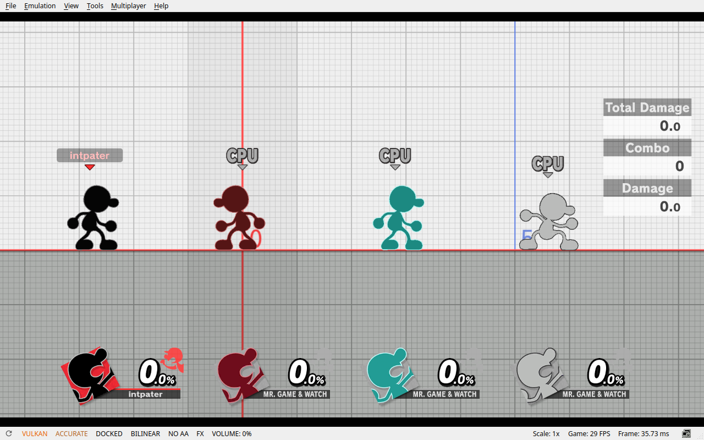
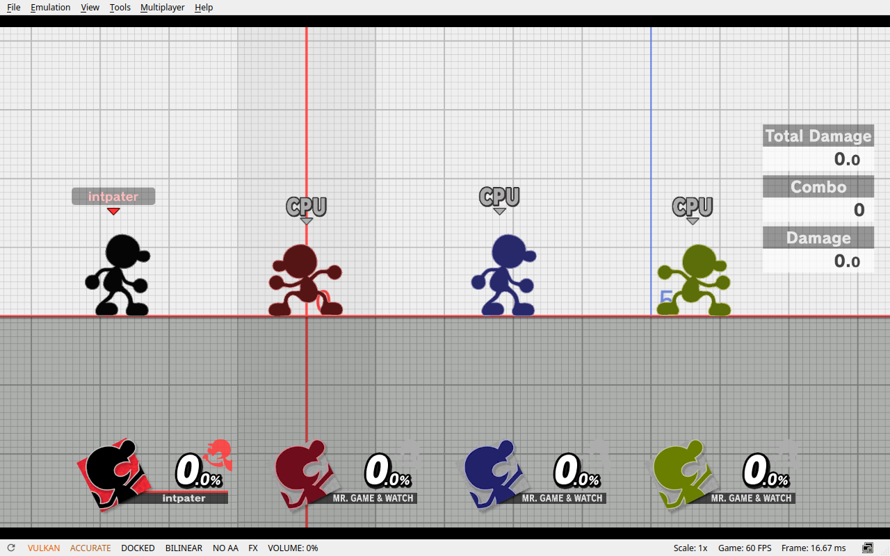
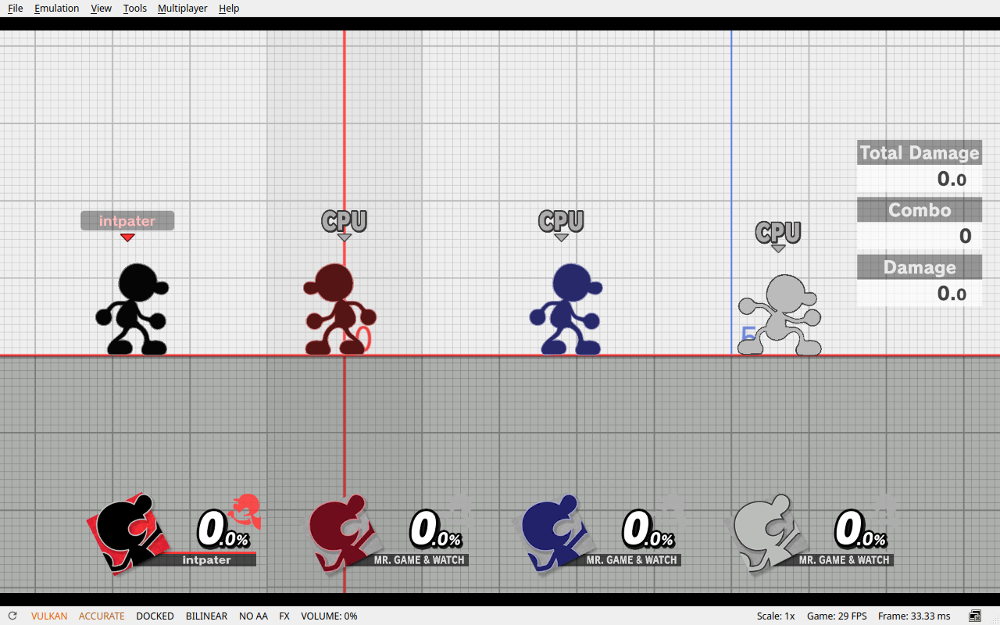

# Eden benchmark — October 9, 2026

**28.00 FPS disabled → 59.99 FPS enabled → 29.00 FPS disabled again.**

This re-verifies the existing corrected `v0.1.1-experimental` binary. It is a
single-machine, stock four-G&W Training comparison, with a return-to-baseline
control. It is separate from the [historical 0.1.0 measurements](VALIDATION.md).

## Results

Each pass has **60 one-second observations over a 60.000-second window**, after
an additional 30-second warm-up in the completed scene. No samples were discarded.

| Metric | Before: disabled | After: enabled | Return control: disabled |
| --- | ---: | ---: | ---: |
| Median game FPS | **28.00258** | **59.98687** | **29.00421** |
| Mean game FPS | 27.38307 | 59.03357 | 29.05001 |
| Minimum sampled FPS | 20.01857 | 41.98667 | 26.98575 |
| Maximum sampled FPS | 29.00875 | 60.04572 | 30.01842 |
| Median GPU utilization | 79% | 28% | 81% |
| Median GPU-reported power | 19.94 W | 10.02 W | 20.31 W |
| GPU temperature range | 64–65 °C | 57–58 °C | 65–66 °C |
| First observation, UTC | 19:40:02.847 | 19:48:18.919 | 19:55:14.429 |
| Last observation, UTC | 19:41:01.846 | 19:49:17.919 | 19:56:13.429 |

The enabled median is **2.14×** the first disabled median and **2.07×** the return
control. The disabled medians differ by about 3.6%. This is an observed improvement
in this workload, not a promise of locked 60 FPS: the enabled window includes a
41.99 FPS observation. Min/max here describe sampled rolling FPS, **not frame-time
percentiles or 1% lows**. GPU telemetry covers the device, not isolated game-only
energy consumption.

### Before and after

| Plugin disabled | Corrected plugin enabled |
| --- | --- |
|  |  |

### Return control

These are unretouched, full `1280×800` application captures taken immediately
before the respective sample windows; menu/status chrome is included. They do
not assert a `1280×800` internal render resolution. End-of-window captures are
also included in the [evidence directory](docs/evidence/2026-10-09/).

All scenes use the Training stage, stock G&W as P1 and all three CPUs, CPU behavior
**Stop**, zero damage, and the same initial positions. The game automatically
assigned the extra CPU costume colors: teal/gray before, blue/green enabled,
blue/gray in the return control. Idle animation phases also differ. These are
comparable stock scenes, not pixel-identical frames or a costume-controlled test.
[Training settings capture](docs/evidence/2026-10-09/training-settings.png).

## System specifications

| Component | Recorded configuration |
| --- | --- |
| Computer | Microsoft Surface Laptop Studio |
| CPU | Intel Core `i7-11370H @ 3.30 GHz`, 4 physical cores / 8 logical CPUs |
| RAM | Nominal 32 GiB; Linux `MemTotal: 32143992 kB` |
| GPU | NVIDIA GeForce RTX `3050 Ti Laptop GPU`, 4,096 MiB VRAM |
| Driver | NVIDIA `610.57.04` |
| OS | Ubuntu `26.04.1 LTS` |
| Kernel | `7.2.6-070206-generic` |
| Power profile | `performance` |
| Window system | Background Xwayland, one Eden instance |
| Game | Super Smash Bros. Ultimate `13.0.5`, confirmed by the live CLI |
| Eden | Local CLI-instrumented build reporting commit `10bcd2d849843b146a79c61a21df615e1bdcfcde` |
| Eden executable SHA-256 | `5427e47ee3d9d195370d22f83da3605afcac7e4fa92216092229260699a57b2d` |

The executable hash is the exact tested identity. The commit is the build's
reported base; this is a locally modified instrumented build, not a pristine
upstream release. All three passes used the same executable.

## Effective Eden settings

These values were queried **after loading Smash, before sampling** and compared
across all three passes. All 26 recorded values and their global/per-game scope
matched. The per-game **Immediate** VSync setting overrides the idle frontend's
FIFO default; the table uses the effective in-game value.

| Setting | Effective value | CLI key / stored value |
| --- | --- | --- |
| Graphics API | Vulkan | `core.backend = 1` |
| Vulkan device | Index 0; NVIDIA ICD selected | `core.vulkan_device = 0` |
| GPU accuracy | High; status bar displays “ACCURATE” | `core.gpu_accuracy = 1` |
| CPU accuracy | Auto | `core.cpu_accuracy = 0` |
| CPU backend | Dynarmic | `core.cpu_backend = 0` |
| Multicore | On | `core.use_multi_core = true` |
| Console mode | Docked | `core.use_docked_mode = 1` |
| Resolution scale | `1×` (`Res1X`) | `core.resolution_setup = 3` |
| Speed limit enabled | On | `core.use_speed_limit = true` |
| Speed limit | 100% | `core.speed_limit = 100` |
| VSync | Immediate; per-game override | `core.use_vsync = 0` |
| Scaling filter | Bilinear; per-game override | `core.scaling_filter = 1` |
| Anti-aliasing | None | `core.anti_aliasing = 0` |
| Anisotropic filtering | Automatic | `core.max_anisotropy = 0` |
| Frame generation | Off | `core.frame_gen = false` |
| Asynchronous GPU emulation | On | `core.use_asynchronous_gpu_emulation = true` |
| Asynchronous shaders | Off | `core.use_asynchronous_shaders = false` |
| Asynchronous presentation | Off | `core.async_presentation = false` |
| Disk shader cache | On | `core.use_disk_shader_cache = true` |
| Vulkan driver pipeline cache | On | `core.use_vulkan_driver_pipeline_cache = true` |
| Reactive flushing | On | `core.use_reactive_flushing = true` |
| Synchronous memory operations | Off | `core.sync_memory_operations = false` |
| Video decoding | GPU | `core.nvdec_emulation = 2` |
| Volume | Muted, saved before boot | `core.volume = 0` |
| Pause in background | Off | `ui.pauseWhenInBackground = false` |
| GameMode preference | Enabled; daemon activation not measured | `ui.enable_gamemode = true` |

Machine-readable canonical values and scope flags: [settings.json](docs/evidence/2026-10-09/settings.json).

## Binary and fixture identity

| Item | Identity |
| --- | --- |
| G&W release tag | `v0.1.1-experimental` |
| G&W source commit | `a534bb533bc0bd5b2fd0af0c518da55647337c44` |
| G&W NRO | `libgnw_render_probe.nro`, 528,384 bytes |
| G&W NRO SHA-256 | `bceef1f09e4339149cdab8e7826d17492680add02307002b0a5d62033d1090c8` |
| Existing ARCropolis loader SHA-256 | `92171b2f4dbd7afe9361a55922f01de7f46ffae09f05185c1cea4ab79dba9a1c` |

The disabled passes loaded only the existing ARCropolis NRO, with Skyline retained.
The enabled pass added only the hash-verified G&W release NRO. The loader is pinned
by its exact binary hash rather than inferred from a historical version label.
The cosmetic-mod and game-load-mod directories were empty. No Training Modpack,
Online Deluxe, FPS mod, replacement G&W skin, or GPU capture was loaded.

The launcher explicitly removed `EDEN_GNW_DEMAND_READBACK` from the child
environment. The enabled [hook log](docs/evidence/2026-10-09/gnw-hook-log.txt)
confirms the verified 4,600-byte shader and narrowed bindings with
`restored=true`. This is the NRO's guarded range optimization, not the separate
unsafe emulator readback diagnostic.

## Method and operational evidence

1. Start one bounded, muted Eden frontend with the isolated profile.
2. Boot Smash `13.0.5`; select the Training stage and stock G&W for P1 and CPU.
3. Set three CPUs and Stop behavior. Visually confirm all four stock fighters.
4. Retain the same persistent shader/pipeline cache between launches; do not clear
   it. After settling in the scene, wait an additional 30 seconds.
5. Capture the application, then query CLI `status.game_fps` once per second for
   60 seconds, alongside `nvidia-smi` telemetry and memory counters. Capture again.
6. Stop the game and frontend cleanly before changing the NRO. Repeat enabled,
   then disabled. Compare effective settings, executable hashes and inventories.

All 180 observations were running, loaded, nonmodal, had fresh statistics, and
reported `shaders_building = 0`. Each emulator had an 8 GiB memory limit, zero
cgroup swap allowance and a 1,800-second ceiling; the host-memory guard's floor
was 3 GiB. Every measured frontend exited normally with code `0`; no memory-limit
hits, OOMs or host-floor stops occurred. Peak memory was 5,930,475,520 /
6,785,699,840 / 6,317,268,992 bytes for before / enabled / control. The original
ARCropolis-only plugin inventory was restored and mute retained.

The first private-Xvfb setup could not write its lockfile because of the host's
`/tmp` user quota. It failed before game boot and is excluded. All three accepted
passes used background Xwayland. A shutdown helper briefly observed a transient
modal while the enabled game was tearing down; waiting for the complete UI
shutdown resolved it, and the frontend exited normally.

## Evidence files

- [Results and exact timestamps](docs/evidence/2026-10-09/results.json)
- Raw observations: [before](docs/evidence/2026-10-09/before-samples.json),
  [enabled](docs/evidence/2026-10-09/after-samples.json),
  [return control](docs/evidence/2026-10-09/control-samples.json)
- [System](docs/evidence/2026-10-09/system.json),
  [settings](docs/evidence/2026-10-09/settings.json),
  [fixture hashes](docs/evidence/2026-10-09/fixtures.json)
- [Resource counters](docs/evidence/2026-10-09/resources.json),
  [restoration](docs/evidence/2026-10-09/restoration.json),
  [SHA-256 manifest](docs/evidence/2026-10-09/SHA256SUMS)

Local game paths are omitted from published samples; measurement values and
timestamps are preserved. No firmware, keys, saves, game files, or shader binaries
are included. The same evidence is attached to each service's release.

This test does not measure physical Switch FPS or establish online/desync safety.
The operator's report that the corrected binary works on Switch is recorded
separately from this instrumented Eden comparison.
